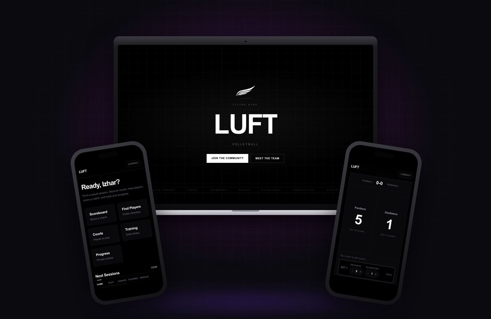
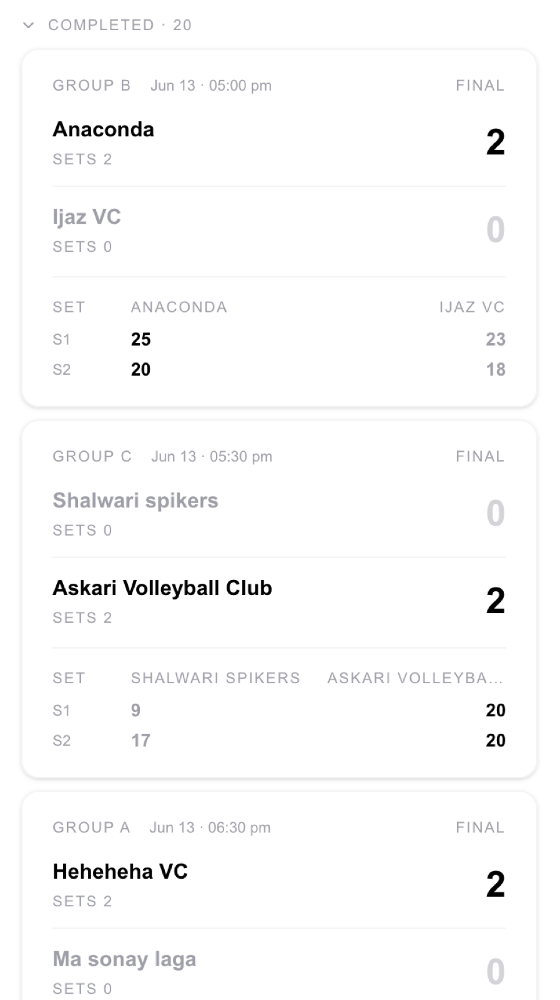
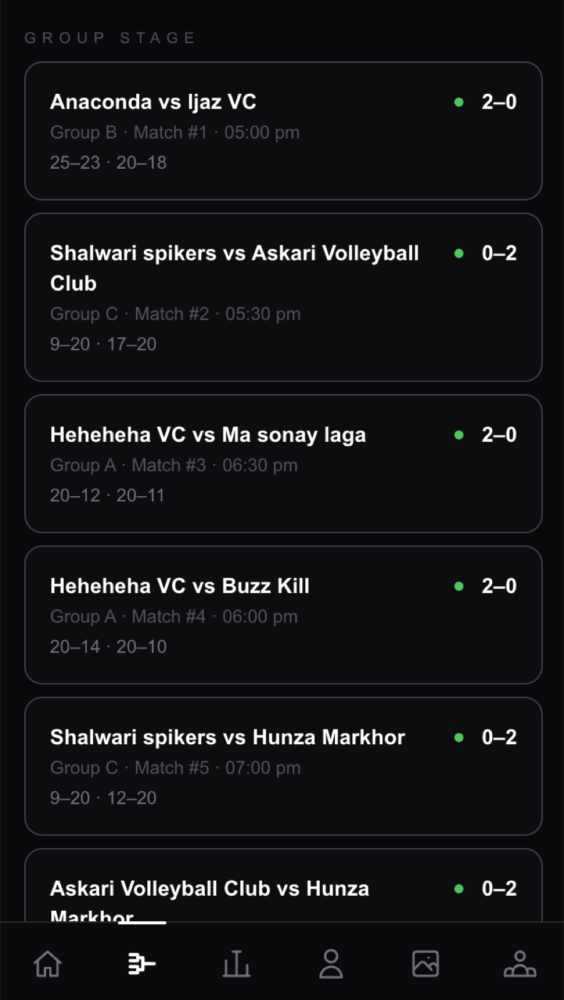
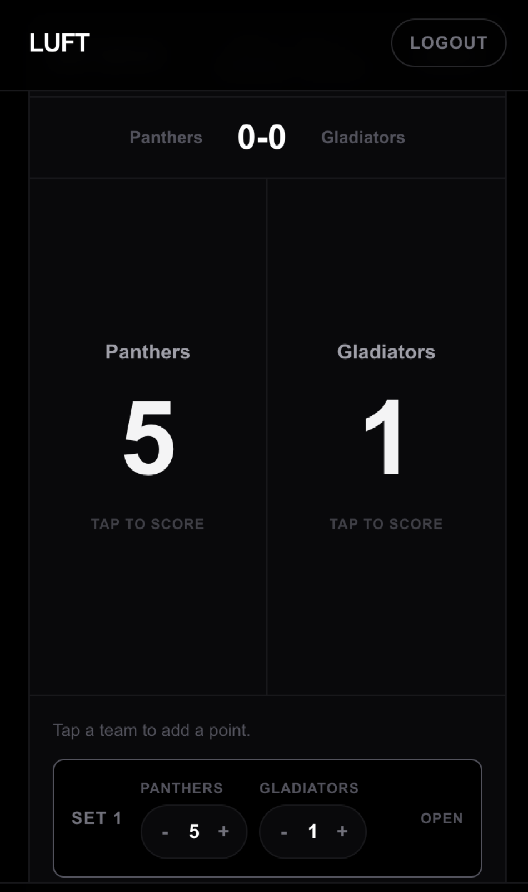
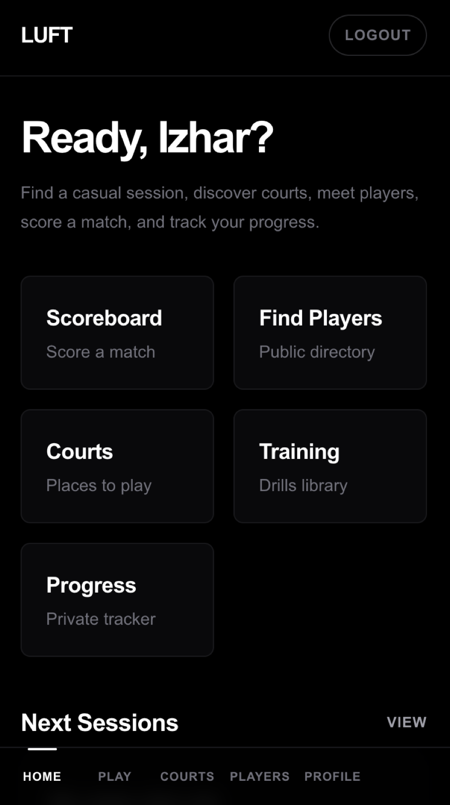
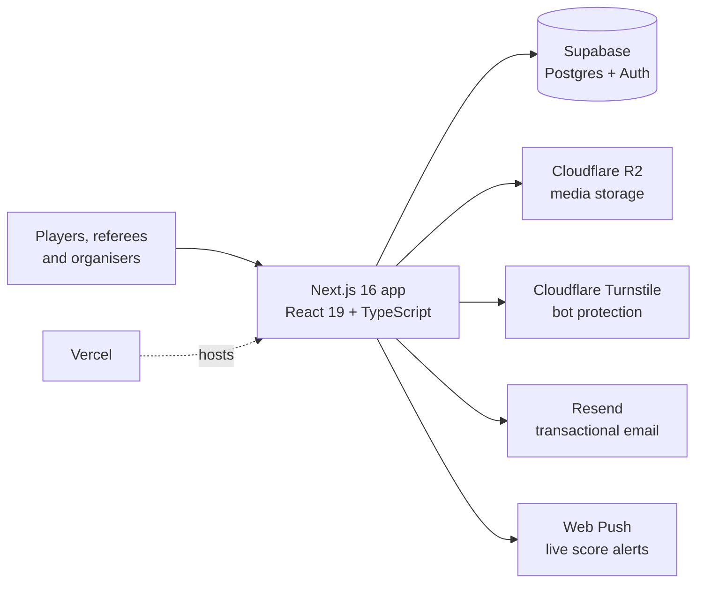

# LUFT

**Volleyball tournament and league platform, live in production with a real community.**

> This is a showcase repo. LUFT's source code is private, so this page covers what it does, how it's built and what it looks like. Happy to walk through the code on a call.

## The problem

Local volleyball leagues were running tournaments and drop-in sessions through spreadsheets and group chats. Bracket seeding, live scoring, roster splitting and payment tracking were slow, error-prone and confusing for organisers, referees and players alike.

## What I built

LUFT is my own product. I designed, built and run it solo, end to end.

- **Drag-and-drop bracket seeding** so organisers set up tournaments in minutes
- **Group standings** with proper tiebreaker logic
- **Live match scoreboard** that referees score courtside, with real-time push notifications to players
- **Session and roster splitting** for pickup play
- **Player training and progress tracking**
- **Multi-role authentication** for organisers, court managers, referees and players, each with their own views
- **Media uploads** for photos from game days
- **Fully custom UI**, built without a component library, mobile-first for courtside use

## Screenshots

## Architecture

## Tech stack

dnd-kit for drag and drop, Web Push for notifications.

## Contact

**Muhammad Izhar** · [izhar.dev](https://izhar.dev) · [LinkedIn](https://linkedin.com/in/izharrr99) · muhammad.izhar11@gmail.com
